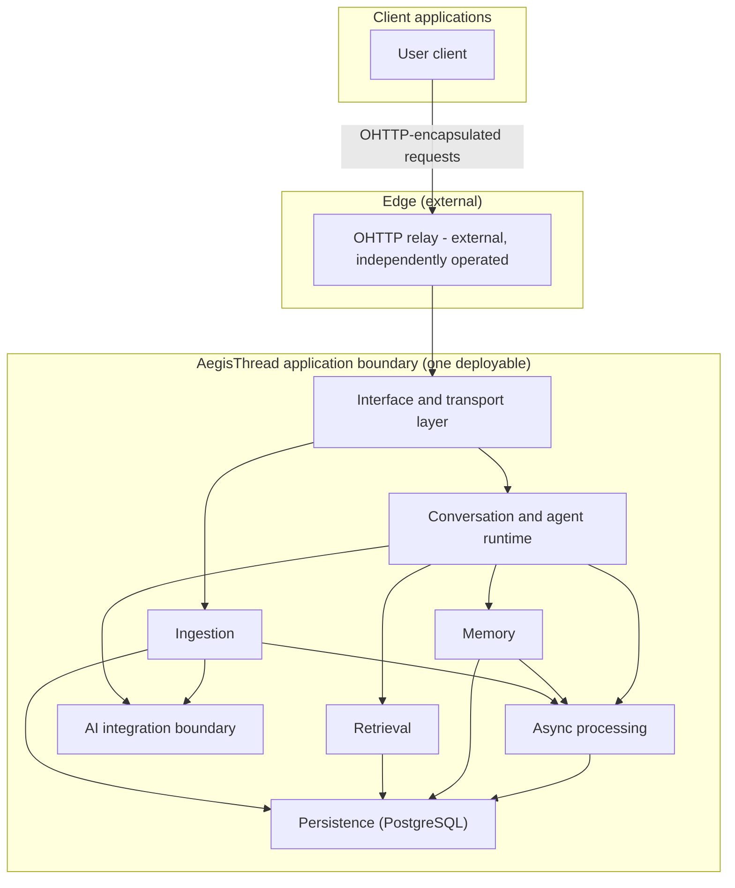
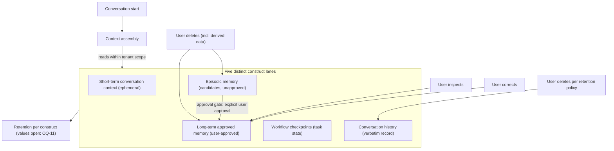
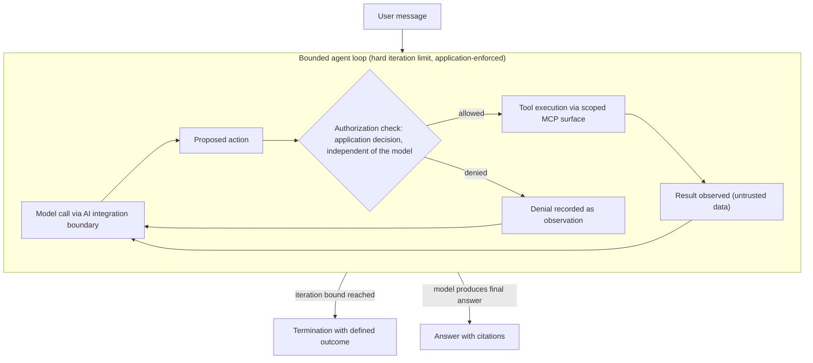
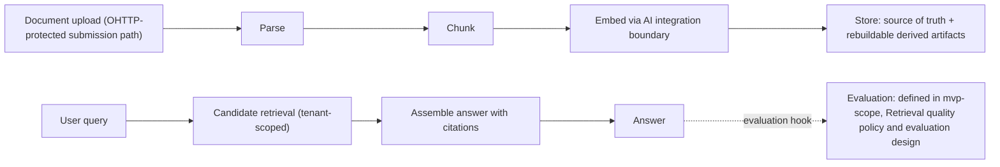
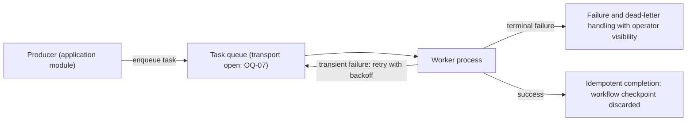
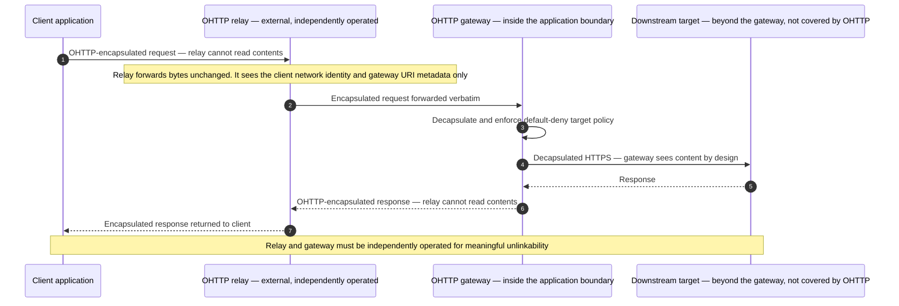

<!-- aegis-thread doc header -->
# System Design

Status: Specification (draft for human review)
Date: 2026-10-24

## Purpose and scope

This document defines the architecture of AegisThread at the level of modules
and responsibilities. **This document defines modules and responsibilities
only — no class names, file paths, or data structures.** (The specification
documents proper — vision, scope, design, plan, glossary, ADRs — name no
implementation files; the M1 setup guide documents the concrete tree.) Names
of external technologies' features in the
[technology stack](#technology-stack) table (for example, index types of an
extension) are verified facts about those technologies, not design
prescriptions for AegisThread.
Concrete technology choices and their verification status live in the
[technology stack](#technology-stack); open questions live in the
[register](../development/implementation-plan.md#open-questions-and-assumptions-register).

Terms are defined once in the
[glossary](../product/glossary.md) and linked, not redefined, here.

Reading order: [product vision](../product/product-vision.md) →
[MVP scope](../product/mvp-scope.md) → this document →
[implementation plan](../development/implementation-plan.md).

## System overview

AegisThread is a modular monolith
([ADR-0001](../adr/0001-modular-monolith-first.md)): one deployable
application in which every module below runs in-process. Clients submit
requests over an OHTTP-protected path through an externally operated relay;
inside the boundary, the interface/transport layer receives decapsulated
requests and routes work to the conversation and agent runtime, the ingestion
and retrieval pipelines, and the memory module — all backed by PostgreSQL as
the single source of truth ([ADR-0002](../adr/0002-postgresql-source-of-truth.md))
and by asynchronous processing for long-running work.

**D1 — High-level architecture**

*Caption: modular monolith — one deployable application; module boundaries
are in-process ([ADR-0001](../adr/0001-modular-monolith-first.md)). The
relay is external and independently operated; it sits outside the
application boundary by design.*

## Modules and responsibilities

- **Interface and transport layer.** In: terminating the OHTTP-protected
  submission path, validating requests, returning uniform errors, and routing
  each request to the use case that owns it. Out: no business decisions and
  no storage access of its own. Invariant: every external request enters the
  application here, and no other module faces the outside directly.
- **Conversation and agent runtime.** In: conducting conversations, running
  the bounded agent loop, invoking the AI integration boundary for model
  calls, and invoking tools only through the scoped MCP surface with
  application-side authorization ([ADR-0007](../adr/0007-mcp-capability-boundary.md)).
  Out: persistence schema decisions and provider selection. Invariant: the
  loop bound is enforced by the application, tool authorization is decided
  independently of the model, and tool output is treated as untrusted data.
- **Ingestion.** In: accepting documents, parsing, chunking, computing
  embeddings through the AI integration boundary, and storing source data and
  derived artifacts. Out: answering questions. Invariant: every write is
  tenant-scoped, and every derived artifact is rebuildable from
  PostgreSQL-resident source data ([ADR-0002](../adr/0002-postgresql-source-of-truth.md)).
- **Retrieval.** In: finding candidate evidence for a query within the
  requesting tenant's boundary and attaching citations to answers. Out:
  answer generation, which belongs to the runtime. Invariant: candidates come
  only from the requesting tenant, and every citation refers to evidence
  actually retrieved for that answer ([FR-CIT](../product/mvp-scope.md#functional-requirements)).
- **Memory.** In: maintaining the lifecycles of the state constructs —
  context assembly inputs, episodic candidates, the approval gate, and the
  user rights to inspect, correct, and delete. Out: any cross-tenant access;
  treating unapproved episodic data as approved. Invariant: the constructs
  remain distinct ([ADR-0003](../adr/0003-separated-ai-state-persistence.md)),
  and deletion cascades to derived data.
- **AI integration boundary.** In: provider-neutral model and embedding
  operations for the runtime and ingestion
  ([ADR-0008](../adr/0008-provider-neutral-ai-boundary.md)). Out: provider
  interfaces anywhere else in the application. Invariant: no provider is
  named outside the open selection question, and privacy-relevant provider
  terms are recorded here — providers whose retention or training terms are
  incompatible with product requirements are rejected.
- **Persistence.** In: holding PostgreSQL as the source of truth, owning
  schema migrations and derived-index rebuilds. Out: business rules.
  Invariant: there is no second system of record, and every read and write is
  tenant-scoped.
- **Async processing.** In: executing long-running work on workers outside
  the request path, with retry, failure recording, and idempotency (see
  [Asynchronous processing](#asynchronous-processing)). Out: user-facing
  request handling. Invariant: a worker outage loses no durable task.

## Memory and state constructs

The five constructs below are the authoritative definitions
([ADR-0003](../adr/0003-separated-ai-state-persistence.md)); the glossary
entries link here. User rights over persistent constructs — inspect,
correct, delete — are stated normatively in
[FR-MEM](../product/mvp-scope.md#functional-requirements) and apply to
constructs that persist for the user (episodic memory, long-term approved
memory, conversation history). Workflow checkpoints persist only
task-scoped: the user-facing surface is task status, not memory items;
checkpoints are discarded or bounded by the task lifecycle.

1. **Short-term conversation context.**
   *Purpose:* hold what the current exchange needs — the current question,
   active document references, in-flight tool results.
   *Lifecycle:* request-scoped; created when a request is assembled and
   discarded when the exchange completes; never promoted into any persistent
   construct.
   *Storage expectations:* ephemeral, in-process, not persisted.
   *Governance:* outside retention and deletion policy because it does not
   persist; still tenant-scoped while it exists.
2. **Episodic memory.**
   *Purpose:* capture candidate facts derived from a session that might
   deserve long-term retention.
   *Lifecycle:* derived from a session; explicitly unapproved; becomes
   long-term approved memory only through the approval gate — an explicit,
   user-approved decision recorded as such, not an automatic data migration;
   otherwise expires or is deleted.
   *Storage expectations:* persisted as unapproved candidate data, in its own
   tenant-scoped storage, separate from long-term approved memory.
   *Governance:* visible only to the user from whose activity it was
   derived, by default; any wider sharing requires an explicit, recorded
   product decision
   ([OQ-17](../development/implementation-plan.md#open-questions-and-assumptions-register));
   never treated as approved memory;
   subject to the user rights above.
3. **Long-term approved memory.**
   *Purpose:* durable facts the user has explicitly approved for future
   sessions.
   *Lifecycle:* created only through the approval gate; persists until the
   user corrects or deletes it; retention period is an open decision
   ([OQ-11](../development/implementation-plan.md#open-questions-and-assumptions-register)).
   *Storage expectations:* persistent, tenant-scoped, in storage separate
   from episodic memory and conversation history.
   *Governance:* every item is inspectable, correctable, and deletable;
   deletion includes all derived data.
4. **Workflow checkpoint.**
   *Purpose:* resumable execution state of a long-running task so that
   interrupted work can continue instead of restarting.
   *Lifecycle:* created by async processing while a task runs, consumed on
   resume, and discarded when the task completes or fails terminally.
   *Storage expectations:* persistent but task-scoped, distinct from all
   conversation-derived data.
   *Governance:* not user-visible memory; retention is bounded by the task
   lifecycle and the open retention decisions.
5. **Ordinary conversation history.**
   *Purpose:* the verbatim transcript record of exchanges, for user review
   and audit.
   *Lifecycle:* appended per exchange; retained per the retention policy
   ([OQ-11](../development/implementation-plan.md#open-questions-and-assumptions-register));
   never silently transformed into any memory construct.
   *Storage expectations:* persistent, tenant-scoped, in its own storage
   representation.
   *Governance:* user-visible; deletable per the retention and deletion
   policy; it is a record, not a memory source.

These five constructs are distinct by design; no construct may be implemented as, substituted by, or merged into another, and no data may migrate between them without an explicit reviewed decision.

**D3 — Conversation and memory lifecycle**

## Conversation and bounded agent loop; MCP interaction

The runtime processes a user message through a bounded agent loop
([glossary](../product/glossary.md#bounded-agent-loop)): a model call through
the AI integration boundary produces a proposed action; the application makes
the authorization decision for that action, independent of the model
([ADR-0007](../adr/0007-mcp-capability-boundary.md)); an allowed action
executes as a tool invocation through the scoped MCP surface, and its result
is fed back as an observation — treated as untrusted data; a denied action is
recorded as an observation. The loop repeats until the model produces a final
answer or the hard iteration bound — a configured maximum enforced by the
application — is reached, in which case the loop terminates with a defined
user-visible outcome. The orchestration approach itself is an open decision
([ADR-0006](../adr/0006-ai-runtime-orchestration-deferred.md)); nothing in
this section commits to one.

**D4 — Bounded agent loop with MCP**

## Document ingestion and RAG

**Ingestion** accepts a document through the OHTTP-protected submission
path, parses it, chunks it, computes embeddings through the AI integration
boundary, and stores the source document and its derived artifacts — source
data in the source of truth, derived artifacts rebuildable
([ADR-0002](../adr/0002-postgresql-source-of-truth.md)). **Retrieval** finds
candidate evidence for a query within the requesting tenant's boundary and
attaches citations to the assembled answer; every citation must reference
evidence actually retrieved for that answer
([FR-CIT](../product/mvp-scope.md#functional-requirements)). Retrieval
quality is governed exclusively by the
[evaluation policy](../product/mvp-scope.md#retrieval-quality-policy-and-evaluation-design);
this document makes no quality statements.

**D2 — Ingestion and RAG flow**

## Asynchronous processing

Long-running work — ingestion, embedding, evaluation runs, deletion cascades
— executes asynchronously: application modules enqueue tasks on a task queue,
and worker processes consume them outside the request path. Transient
failures are retried with backoff; terminal failures move to failure and
dead-letter handling with operator visibility. Tasks must be idempotent so
that retries cannot duplicate effects, and a worker outage must lose no
durable task. The concrete transport technology is deliberately open
([OQ-07](../development/implementation-plan.md#open-questions-and-assumptions-register));
the design above depends only on queue, worker, retry, and failure
semantics — not on any named transport.

**D6 — Asynchronous path (transport-neutral)**

## OHTTP integration and trust model

The facts below are normative; they restate, at the architecture level, the
decision in [ADR-0004](../adr/0004-ohttp-scope-client-to-gateway.md):

- OHTTP protects the **client-to-gateway boundary only**.
- The **gateway sees decapsulated request contents by design** —
  decapsulation is required to process requests.
- The **relay cannot read** protected request contents; it does see the
  client's network identity and gateway URI metadata.
- OHTTP does **not** provide end-to-end protection to the AI provider or to
  any downstream target; protection ends at the gateway.
- **Meaningful unlinkability requires an independently operated relay and
  gateway** (hosting topology: OQ-13).
- **Key lifecycle:** generate → advertise (the public key configuration is
  distributed over an authenticated channel) → rotate/retire; retired keys
  still decrypt in-flight traffic while clients refresh; no automatic
  client-side refresh is assumed.
- **Target policy:** default-deny — only explicitly allowed hosts, schemes,
  and ports are reachable; loopback, private, link-local, and metadata
  addresses (including 169.254.169.254) are rejected; unresolvable targets
  fail closed.
- **DNS-rebinding caveat:** target validation happens before forwarding, but
  the outbound HTTP client re-resolves DNS at connection time; therefore
  network-level egress control is a deployment requirement, not an option
  ([OQ-09](../development/implementation-plan.md#open-questions-and-assumptions-register)).
- **Replay tracking** beyond the RFC's Date recommendation is not assumed;
  hardening is an open decision
  ([OQ-10](../development/implementation-plan.md#open-questions-and-assumptions-register)).
- **Supply-chain posture:** the candidate PHP library is verified (2026-10-24)
  as release-less development-branch-only with a 0.x HPKE dependency
  ([technology stack](#technology-stack)); adoption requires commit-pinning
  plus a contingency plan
  ([OQ-03](../development/implementation-plan.md#open-questions-and-assumptions-register),
  [OQ-15](../development/implementation-plan.md#open-questions-and-assumptions-register)),
  and the integration sits behind the transport abstraction of
  [ADR-0005](../adr/0005-ohttp-behind-transport-abstraction.md).
- **Error behavior:** pre-decapsulation failures return a uniform plaintext
  error (decryption failures are indistinguishable to the sender);
  post-decapsulation failures are returned encapsulated; logs record status
  codes and error classes — never request bodies, URLs, or key material.

**D5 — OHTTP path: client → relay → gateway → target**

## Privacy and data protection requirements

Privacy, tenant isolation, prompt injection, outbound restrictions,
retention, and deletion are day-one architectural concerns. The requirements
below are authoritative for the architecture
(constraint fixed by the human project owner, 2026-10-24):

- **Tenant isolation.** Data shall be isolated per tenant at every layer;
  **no cross-tenant read path shall exist at any layer** — storage,
  retrieval, memory, or tool execution — by design, and to be verified once
  implementation exists. Every read and write is tenant-scoped. Isolation is
  a hard requirement independent of the deployment topology, which remains
  open
  ([OQ-01](../development/implementation-plan.md#open-questions-and-assumptions-register)).
- **Object-level authorization.** Every read and write of a user-derived
  resource — user-derived data in all three state domains of
  [ADR-0003](../adr/0003-separated-ai-state-persistence.md) (semantic
  memory, workflow checkpoints, conversation history), conversation
  sessions, document uploads, and every artifact derived from any of them —
  requires an object-level authorization
  check of the requesting user's relationship to that specific resource,
  independent of tenant membership. Tenant isolation and object-level
  authorization are separate requirements; both are mandatory.
- **Default visibility.** Documents, memory constructs, and other resources
  derived from a user's activity are visible to that user only, by default.
  Any wider sharing (team or
  workspace level) requires an explicit, recorded product decision
  ([OQ-17](../development/implementation-plan.md#open-questions-and-assumptions-register)).
- **Prompt-injection surface.** Untrusted documents and tool output are
  **data, never instructions**. Content from ingestion or tool execution
  cannot change the instructions the application executes, and the
  authorization decision for any tool use is made by the application
  independently of the model
  ([ADR-0007](../adr/0007-mcp-capability-boundary.md)).
- **Outbound request restrictions.** Egress is **default-deny**: requests to
  external services — AI providers and targets reached through the OHTTP
  gateway — are allowed only to explicitly permitted destinations. This
  applies at the application layer (allowlist target policy) and as a
  network-level deployment requirement
  ([OQ-09](../development/implementation-plan.md#open-questions-and-assumptions-register)).
- **Retention.** Retention is defined **per construct** — the five constructs
  of [Memory and state constructs](#memory-and-state-constructs) have
  distinct retention; the concrete periods are open decisions
  ([OQ-11](../development/implementation-plan.md#open-questions-and-assumptions-register)).
- **Deletion including derived data.** Deleting an item deletes the item and
  everything derived from it — **embeddings, extracted text, caches, and
  derived checkpoints included** — across all systems under AegisThread
  operator control. Deletion is complete only when no derived artifact
  remains in those systems; the rebuildability rule of
  [ADR-0002](../adr/0002-postgresql-source-of-truth.md) makes this
  verifiable. Content transmitted to an AI provider persists under that
  provider's retention terms, which AegisThread cannot technically enforce;
  AegisThread can select for, record, and disclose those terms
  ([ADR-0008](../adr/0008-provider-neutral-ai-boundary.md)).
- **Asynchronous copies.** Task-queue payloads carry the minimum necessary
  data — identifiers and references over content where feasible. Failure and
  dead-letter transports are retention-bounded and must be reconciled with
  deletion: queued or failed work derived from deleted content is purged.
  Broker access is treated as a potential read surface and requires access
  control
  ([OQ-07](../development/implementation-plan.md#open-questions-and-assumptions-register)).
- **Citation integrity.** Citations reference evidence actually retrieved
  for the requesting tenant's answer
  ([FR-CIT](../product/mvp-scope.md#functional-requirements)); answers must
  not reference content that was not retrieved for that tenant.

### Threat model: explicitly deferred

A full threat model — attacker personas, abuse cases, trust-boundary
analysis — is out of scope for the specification increment (2026-10-24) and
is tracked as
[OQ-12](../development/implementation-plan.md#open-questions-and-assumptions-register).
It must be produced before the MVP is treated as operationally complete. The
deferral does not weaken the requirements above; they are binding regardless
of threat-model status.

## AI integration boundary

All model and embedding access passes through the application-owned,
provider-neutral integration boundary
([ADR-0008](../adr/0008-provider-neutral-ai-boundary.md)). No provider is
named as chosen anywhere in this corpus; provider and embedding-model
selection is open
([OQ-05](../development/implementation-plan.md#open-questions-and-assumptions-register)).
When a provider is selected, its privacy-relevant terms (retention, training
usage, logging) are recorded at this boundary; providers whose terms are
incompatible with product requirements are rejected.

## Technology stack

Status vocabulary (Verified / Proposed / Open) as normatively defined in the
[implementation plan ground rules](../development/implementation-plan.md#ground-rules).
Facts below come from
the research dossier verified on 2026-10-24; rows re-verified during M1
(2026-10-25) carry their own later date in the Verified column.

| Item | Role | Status | Source(s) | Verified |
|---|---|---|---|---|
| PHP ≥ 8.4 floor (Symfony 8.x); runtime of record PHP 8.5 (Docker) | Language floor and runtime | **Verified** — Symfony 8.x requires PHP ≥ 8.4; PHP 8.5 is the runtime of record (Docker image `php:8.5-cli`, [ADR-0009](../adr/0009-symfony-8x-line-and-php-runtime.md)). The OHTTP candidate library's PHP ^8.2 requirement remains satisfied (that fact verified 2026-10-24) | https://www.php.net/supported-versions.php, https://symfony.com/releases, https://packagist.org/packages/gcorradomms/ohttphp | 2026-10-25 |
| Symfony (version line) | Application framework | **Decided** — 8.x line adopted starting at 8.1 ([OQ-02](../development/implementation-plan.md#open-questions-and-assumptions-register) closed 2026-10-25 via [ADR-0009](../adr/0009-symfony-8x-line-and-php-runtime.md)); re-verified fact-set: 8.1 current stable since 2026-05-29, PHP ≥ 8.4, latest 8.1.9, all support ends 2027-01-31; 8.2 due 2026-11; 8.4 LTS expected 2027-11; the project tracks the 8.x cadence until the 8.4 LTS | https://symfony.com/releases and https://endoflife.date/symfony | 2026-10-25 |
| gcorradomms/ohttphp | OHTTP (RFC 9458) client/relay/gateway library | **Proposed** — release-less: dev-main only on Packagist (published 2026-10-12), no tagged release, single-commit repository, 0.x HPKE dependency (paragonie/hpke ^0.8.0); requires commit-pinning plus contingency (OQ-03, OQ-15) and integration only behind [ADR-0005](../adr/0005-ohttp-behind-transport-abstraction.md). Covers all three OHTTP roles; PSR-7/17/18/15 based; PHP ^8.2 with ext-gmp and ext-openssl; default-deny target policy with fail-closed behavior; RFC 9458 Appendix A interop vectors in its test suite | https://github.com/GCorradoMMS/ohttphp and https://packagist.org/packages/gcorradomms/ohttphp; RFC 9458: https://www.rfc-editor.org/rfc/rfc9458.html | 2026-10-24 |
| MCP PHP SDK (mcp/sdk) | Tool capability surface | **Proposed** — official SDK, GA 2025-09-05 (PHP Foundation + Symfony team + Anthropic MCP team collaboration); framework-agnostic, servers and clients, STDIO + HTTP transports, sessions, authorization; Symfony bundle integration exists. **Tier 3 in the official SDK tier list — the youngest tier — recorded as a maturity risk** requiring an upgrade policy (OQ-04) | https://github.com/modelcontextprotocol/php-sdk, https://packagist.org/packages/mcp/sdk, https://php.sdk.modelcontextprotocol.io, https://blog.modelcontextprotocol.io/posts/2025-09-05-php-sdk, https://modelcontextprotocol.io/docs/2026-07-28/sdk | 2026-10-24 |
| PostgreSQL + pgvector ≥ 0.8.7 | Source of truth + vector retrieval | **Proposed** — pgvector 0.8.x line, latest 0.8.7 (2026-10-01), supports PostgreSQL 13+; HNSW indexes, iterative scans for filtered queries, halfvec quantization. Pin ≥ 0.8.7: CVE-2026-3172 (buffer overflow in parallel HNSW builds) fixed in 0.8.2; deployed in the development environment as the pinned image pgvector/pgvector:0.8.7-pg18 (Verified 2026-10-25); the vector-retrieval capability itself remains Proposed pending M2 confirmation per [ADR-0002](../adr/0002-postgresql-source-of-truth.md) | https://github.com/pgvector/pgvector/blob/master/CHANGELOG.md and https://www.postgresql.org/about/news/pgvector-082-released-3245/ | 2026-10-24 |
| Symfony Messenger | Asynchronous task transport | **Proposed** — transport choice **Open** ([OQ-07](../development/implementation-plan.md#open-questions-and-assumptions-register)). Verified capabilities: AMQP transport via the amqp extension (RabbitMQ, amqps TLS with cacert) and Redis streams transport (redis extension ≥ 4.3, Redis server ^5.0); retry strategy (retries, delay, multiplier, jitter), failure transport, supervised consume workers | https://symfony.com/doc/current/messenger.html | 2026-10-24 |
| Next.js 16.x | Web client | **In scope** — web client in MVP scope ([OQ-14](../development/implementation-plan.md#open-questions-and-assumptions-register) closed 2026-10-25); 16.x current (16.4.x), first slice delivered in M1 | https://nextjs.org/blog/next-16-4, https://github.com/vercel/next.js/releases, https://www.herodevs.com/blog-posts/nextjs-eol-dates-version-support-timeline | 2026-10-25 |
| AI provider / embedding model | Model and embedding access | **Open** — no provider or model selected ([OQ-05](../development/implementation-plan.md#open-questions-and-assumptions-register)); all access behind [ADR-0008](../adr/0008-provider-neutral-ai-boundary.md) | none — selection pending | 2026-10-24 (status review) |
| CI and quality tooling (GitHub Actions, PHPUnit, PHPStan, PHP-CS-Fixer, Docker Compose) | Test/CI/quality baseline | **Verified** — tooling baseline for M1; checks run in Docker against the runtime of record | https://docs.github.com/actions, https://phpunit.de, https://phpstan.org, https://cs.symfony.com | 2026-10-25 |

## Architectural decision index

| ADR | Title | Decision in one line | Status |
|---|---|---|---|
| [ADR-0001](../adr/0001-modular-monolith-first.md) | Initial architecture: modular monolith | One deployable application with explicit in-process module boundaries; no infrastructure without concrete need. | Accepted |
| [ADR-0002](../adr/0002-postgresql-source-of-truth.md) | PostgreSQL is the source of truth | All durable product state in PostgreSQL; derived stores rebuildable; no second system of record. | Accepted |
| [ADR-0003](../adr/0003-separated-ai-state-persistence.md) | Separate persistence for semantic memory, workflow checkpoints, and conversation history | Distinct data domains with distinct lifecycles; never interchangeable. | Accepted |
| [ADR-0004](../adr/0004-ohttp-scope-client-to-gateway.md) | OHTTP protects the client-to-gateway boundary only | OHTTP adopted with an honestly stated scope; no end-to-end claims. | Accepted |
| [ADR-0005](../adr/0005-ohttp-behind-transport-abstraction.md) | OHTTP integration sits behind an application-facing transport abstraction | The library API lives only in an adapter; pin/replace/fork stays local. | Accepted |
| [ADR-0006](../adr/0006-ai-runtime-orchestration-deferred.md) | AI runtime orchestration approach: decision deferred | Orchestration undecided; bounded in-process agent loop is the working default. | Open |
| [ADR-0007](../adr/0007-mcp-capability-boundary.md) | MCP as a scoped capability boundary | Tools reachable only through MCP with application authorization independent of the model. | Accepted |
| [ADR-0008](../adr/0008-provider-neutral-ai-boundary.md) | Provider-neutral AI integration boundary | All model/embedding access behind an application-owned seam; no provider named. | Accepted |
| [ADR-0009](../adr/0009-symfony-8x-line-and-php-runtime.md) | Symfony 8.x line and PHP 8.5 runtime | 8.x line starting at 8.1; PHP 8.5 Docker runtime; upgrade cadence to 8.4 LTS accepted. | Accepted |

## Glossary

All terms are defined once in the [glossary](../product/glossary.md).

## Links

- [Product vision](../product/product-vision.md)
- [MVP scope](../product/mvp-scope.md)
- [Implementation plan](../development/implementation-plan.md)
- [Glossary](../product/glossary.md)
- [ADR-0001](../adr/0001-modular-monolith-first.md) through [ADR-0009](../adr/0009-symfony-8x-line-and-php-runtime.md)
