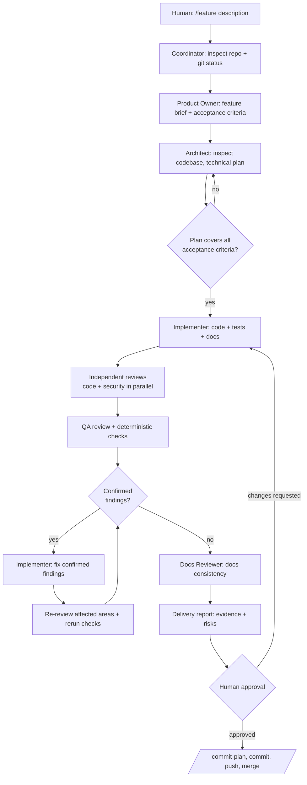

# Agent Workflow

How feature development runs in this repository with OpenCode. This document
describes the **development process** — the tooling we use to build AegisThread.
It does not describe the AegisThread product runtime (see
[OpenCode agents vs. the AegisThread runtime](#opencode-agents-vs-the-aegisthread-runtime)).

## Lifecycle

Every new feature follows the same loop. The **Build** agent (OpenCode's
built-in primary agent) is the coordinator you talk to; it delegates work to
specialized subagents defined in `.opencode/agents/`.

The entry point is the `/feature` command. `/review`, `/release-check`, and
`/commit-plan` reuse parts of the loop standalone.

## Roles, permissions, and handoffs

| Role | Agent | Edits files? | Consumes | Produces |
|------|-------|--------------|----------|----------|
| Coordinator | `build` (built-in) | Yes | Your instructions | Orchestration, delivery report |
| Product Owner | `product-owner` | No | Feature description | Brief: problem, story, requirements, acceptance criteria, edge cases, non-goals, risks |
| Architect | `architect` | No | Approved brief + repo | Plan: steps, files, contracts, required tests, trade-offs, ADR proposals |
| Implementer | `implementer` | **Yes** (only code-writer in a feature cycle) | Brief + approved plan | Code, tests, migrations, docs, real check results |
| Code Reviewer | `code-reviewer` | No | Diff + context | Severity-ranked findings with evidence and failure scenarios |
| Security Reviewer | `security-reviewer` | No | Diff + context | Threat-oriented findings, questions/risks separated from confirmed issues |
| QA Reviewer | `qa-reviewer` | No | Diff + acceptance criteria | Coverage matrix, verification gaps, test-quality findings |
| Docs Reviewer | `docs-reviewer` | No | Final state | Documentation findings, undocumented assumptions |

Handoff rule: a role only starts when its input is complete. The Architect
does not start without the brief; the Implementer does not start with a plan
that leaves acceptance criteria uncovered; reviewers do not start without a
defined change set.

## Permissions

Permissions are enforced by OpenCode configuration, not just prompts:

- Project baseline (`opencode.json`): Git commits, merges, rebases, resets,
  pushes and similar history-affecting commands require explicit approval;
  `git clean`, `git reset --hard`, and forced pushes are denied outright.
  Access outside the repository requires approval.
- All specialized agents except the Implementer: `edit: deny`, no subagent
  delegation. Reviewers may run only read-only Git inspection
  (`status`, `diff`, `log`, `show`, `branch`); the security and QA reviewers
  may run other commands (e.g. dependency audits, test suites) only with
  per-command user approval.
- Implementer: file editing allowed; Git write operations denied at the tool
  level; everything else asks.

Changing these rules is itself an architectural decision — do it consciously,
in a reviewed change, not mid-feature.

## Approval gates

1. **Plan gate** — the plan must cover every acceptance criterion and respect
   the non-goals before implementation starts.
2. **Review gate** — no Critical or High finding may remain open unless the
   human explicitly accepts it with a recorded rationale.
3. **Evidence gate** — every claim of "tests pass" or "CI green" must have
   execution evidence from a real session.
4. **Human release gate** — a PASS from `/release-check` is input to a human
   decision, never a substitute for it. Only the human commits, pushes,
   merges, or deploys.

## Failure handling

- **Plan is wrong or incomplete mid-implementation** — the Implementer stops
  and reports; the coordinator routes back through the Architect. No silent
  redesign.
- **Reviewer disagreement** — resolved by inspecting evidence, not by
  majority vote (see `review-policy.md`).
- **Checks cannot run** (missing service, credentials, no baseline commit) —
  recorded as unverified in the delivery report, never skipped silently.
- **Unrelated uncommitted work is present** — it is preserved and excluded
  from feature commits; `/commit-plan` lists it separately.
- **Scope pressure** — new ideas discovered during implementation are
  recorded as suggestions, not implemented without a fresh approval.

## OpenCode agents vs. the AegisThread runtime

These are two different kinds of agents and must not be confused:

- **OpenCode agents** (`.opencode/agents/`) are *development-process tooling*.
  They help humans build software: briefs, plans, diffs, reviews. They run in
  the developer's environment, they have no product authority, and they never
  ship inside the product. This workflow is plain OpenCode orchestration —
  primary agent + subagents — **not** a LangGraph workflow.
- **AegisThread runtime agents** are *product features*: long-running AI
  behavior inside the application, implemented in this repository as part of
  the Symfony runtime, with their own model integrations, tools, and
  permissions. How runtime behavior is orchestrated is an open architectural
  decision — see [ADR-0006](../adr/0006-ai-runtime-orchestration-deferred.md).

Consequences: changes to AegisThread's runtime agents go through THIS workflow
(brief → plan → implement → review), exactly like any other product code.
This workflow's own configuration (`.opencode/`, `docs/engineering/`) is
engineering tooling and never part of the AegisThread deliverable. Do not import
AegisThread product concepts (OHTTP gateway, MCP tool permissions) into OpenCode
agent files except as review criteria for AegisThread code.

## Proportionality

Small fixes (typo, one-line bug with an obvious test) do not need the full
ceremony: implement directly, run the relevant checks, done. Use the full
lifecycle when the change adds a feature, touches auth/data/money, changes
architecture or contracts, or introduces runtime agent behavior. When in
doubt, run `/review` at minimum before asking for approval.
